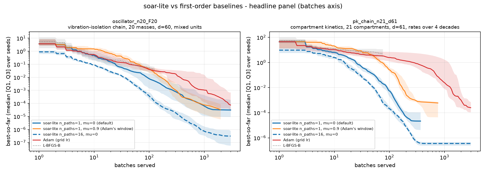
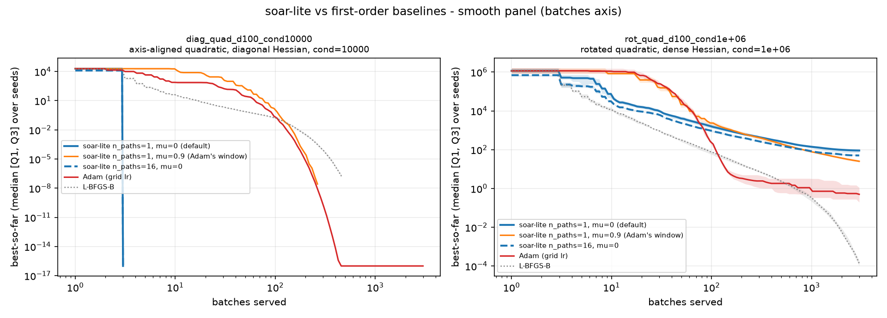
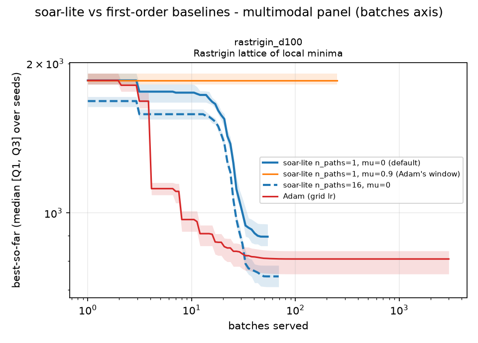
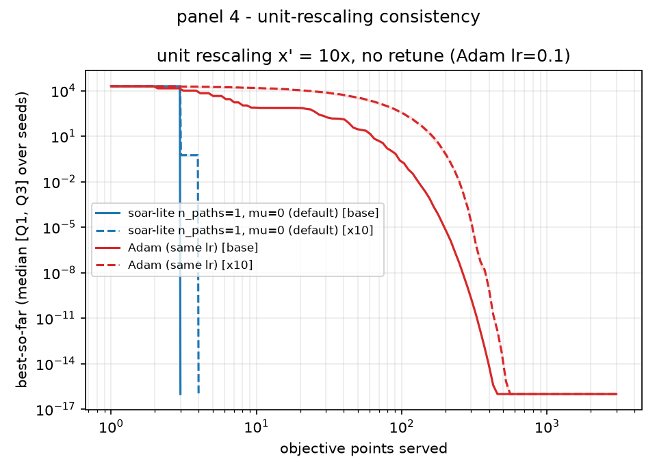

# soar-lite

[](https://github.com/watson-tree/soar_lite/actions/workflows/ci.yml)
[](https://colab.research.google.com/github/watson-tree/soar_lite/blob/main/notebooks/run_panels.ipynb)

A JAX optimizer for objectives that are differentiable but expensive to
evaluate. The caller passes value and gradient together, so there is no Hessian
to assemble and no second-order system to solve: each coordinate carries its own
step length instead.

**Use it when** the objective is differentiable, one evaluation costs real time
or money, and the search space is moderate- to high-dimensional.

**Skip it when** there is no gradient to pass — a gradient-free objective is out
of scope — or when a plain multistart local solve is affordable: if a few
scrambled starts plus a quasi-Newton method find the answer cheaply, that costs
you less. See [when this fits](docs/explanation/how-it-works.md#when-this-fits) for
the reasoning.

A run moves `n_paths` paths in lockstep, each following its own descent; an
iteration is usually one fused pass, a single call returning value and gradient
for every served point, unless the method enumerates candidates, which spends
trial rounds of its own first and one fused batch settling the winner (see
[How it works](docs/explanation/how-it-works.md)). On a GPU a wider batch barely
costs more wall-clock than a narrow one, which is why the engine is built around
batched evaluations; on a CPU the same run works, just without that saving.

## Install

```bash
pip install soar-lite                 # CPU build: no GPU needed
pip install soar-lite 'jax[cuda12]'   # GPU: CUDA 12 driver
pip install soar-lite 'jax[cuda13]'   # GPU: CUDA 13 driver
```

Requires Python 3.11 or newer; the distribution is `soar-lite`, the import
`soar_lite`. It declares plain `jax` (the CPU build) so an install never needs a
GPU, and holds no GPU-specific code — only the JAX backend differs. The CUDA
build is a JAX extra, so the CUDA version is your choice, not one this package
pins. JAX picks its backend from what is installed; to pin one inside a process,
call `jax.config.update("jax_platform_name", "cpu")` — or `"cuda"` — before any
JAX work.

## Minimal run

```python
import jax.numpy as jnp
from soar_lite import Domain, n_path_schedule, pointwise


def squares(x):  # one point (d,) in, one scalar out
    return jnp.sum((x - 3.0) ** 2)


# pointwise returns two functions: eval_f_g for value and gradient in one pass,
# and eval_f for the value alone. This run needs only the first; `eval_f` is the
# value-only seam for a step's trials, not a gradient-free entry.
eval_f_g, _ = pointwise(squares)

result = n_path_schedule(
    eval_f_g,
    domain=Domain([(-5.0, 5.0), (-5.0, 5.0)]),  # (lower, upper) per dimension of x
    n_paths=4,
    max_iters=30,
)
print(result.x)  # x ≈ [3. 3]
print(result.f)  # f ≈ 3e-5
```

`x` is the best point the run evaluated, shape `(d,)`, and `f` is its value: the
argmin over the feasible points that were served. The flock is the points the
paths hold at one moment, one per path, so `flock_x` is the flock as the run
ended. The result names the answer `x` and `f`, and the flock pair prefixes those
same two names with `flock_`; the extra fields are `work` (the four counts, which
also read flat on the result), `n_iters`, and a `status`.

## Results

Each method gets the same objective, the same seeds and the same batch budget -
but not the same tuning effort, and that difference runs in Adam's favour:
Adam's learning rate is picked per problem from a log grid (the `lr` sweep),
while soar-lite's `n_paths` and `mu` are the same on every panel. So where
soar-lite comes out ahead, it beats a tuned baseline, not a default one.

Two axes are plotted, and they answer different questions. The panels below are
the batches axis: one batch is one parallel pass - the wall clock of a GPU
setting, which is what this library is built for - and on that axis a wider
batch barely costs more. The points axis charges that width per point instead,
so `n_paths=16` pays there for what it got nearly free here; the points-axis
copies are in [`docs/figures/`](docs/figures/), and they are worth a look before
the batches axis is read as a ranking.

A curve is best-so-far, the line a median over 20 seeds and the band its Q1-Q3
spread, over 3000 batches. Where a curve stops and its neighbours run on, that
arm stopped serving batches - converged, or stalled out - and the line is cut at
its cohort's first stop rather than carried to the budget; the space to its
right is the arm's absence, not a further measurement. Click a panel for the
full size.

Read across like with like, because the arms move more than one knob: width is
`n_paths=16` against `n_paths=1` at `mu=0`, momentum is `mu=0.9` against `mu=0`
at `n_paths=1`. Adam carries the same 0.9 gradient EMA, so it is read against
the `mu=0.9` arm - and even there the comparison is momentum-aligned rather than
single-knob, since Adam also carries a second moment and a tuned learning rate.
Neither `mu` wins on every panel: start from `mu=0`, the default, and read the
momentum arm panel by panel.

[](docs/figures/headline-batches.png)

**The two real inverse problems** - a mixed-unit oscillator chain and a
non-convex compartment chain. The wide `n_paths=16` arm is shown whole, paying
16 objective points per batch for that width; it is not ahead on both axes.

[](docs/figures/smooth-batches.png)

**Two quadratics, 100 dimensions each** - one diagonal and conditioned at `1e4`,
where a per-coordinate estimate is exact, one rotated and conditioned at `1e6`,
where it is not. The diagonal one is a positive control rather than a contest -
the case the secant was built for. On the rotated one soar-lite trails Adam and
L-BFGS-B by design: the dropped off-diagonal curvature is the boundary the
global side exists to cross.

[](docs/figures/multimodal-batches.png)

**A multimodal landscape, read as a boundary** - Rastrigin in 100 dimensions.
It is not a race but a boundary: the secant damps where the gradient reverses
sign, so the local solver settles in the nearest well and has no mechanism for
crossing a ridge into a better one. Multimodal reach is the global layer's job -
more paths and restarts do the exploring. The wider arm's lead is its sixteen
starts rather than a faster descent.

[](docs/figures/invariance-units.png)

**Unit invariance.** One physics measured in two unit systems (`x' = 10x`) with
nothing retuned: the per-coordinate secant overlaps, while a single global
learning rate separates because the effective step rescales with the unit.

Both axes of all four panels, and the Adam `lr` sweep, are in
[`docs/figures/`](docs/figures/); the medians behind every curve and the caveats
that qualify them are in `experiments/RESULTS.md`, what the comparison measures
is in `experiments/DESIGN.md`, and the commands that redraw the set are in
[`docs/figures/README.md`](docs/figures/README.md).

Those files are named by path rather than linked because the harness under
`experiments/` is a benchmark sub-library, not a dependency: it imports
soar-lite, nothing in the package or these docs depends on it, and it ships in
neither the wheel nor the sdist. The figures are a snapshot of one run, so
reading a result does not need the harness.

To run any panel yourself, open
[`notebooks/run_panels.ipynb`](notebooks/run_panels.ipynb) (what the Colab badge
above opens): one section per panel, with the figure each run writes.

## What's inside

Two plugin seams — extension points you can swap — under one engine that
schedules the work, and nothing beyond JAX and the standard library.

- **The engine, `n_path_schedule`** — runs the `n_paths` paths in lockstep and
  owns the domain, the run's gates (`max_iters` and `time_limit`, plus the
  caller's `budget_check`), and the restart schedule: a path stalls when its
  `propose` answers `None` or its point fails the finite gate, and the engine
  redraws it from a fresh point. A stalled path that holds a point is re-drawn
  only with `restart_stalled` on; one that holds none is always re-drawn.
- **The local method, `LocalSolver`** — one path's descent step: direction,
  step size, acceptance, and how many points a step looks at. One `propose` call
  is one step, so a method may rule its own trial grid and name its own winner,
  which the engine then settles. `DiagonalPreconditioner` is the default: a
  per-coordinate inverse-curvature scale re-estimated from successive gradients,
  no matrix and no scalar learning rate to tune, and a momentum `mu` (0 by
  default) blending the gradient with its own history.
- **The restart source, `GlobalModel`** — where a restarted path is placed, plus
  the run's evidence sink; it also places iteration 0's flock when `x0` is left
  `None`. `SampleGlobalModel` is the default: it ignores the evidence and draws
  from the domain; `BLRGlobalModel` accumulates it into a Bayesian surrogate for
  the same contract.

The two plugin seams are keyword arguments: pass `local_solver=` or
`global_model=` to replace either.

What ships is not a general-purpose toolkit but a small set of defaults picked by
judgment — which is what `-lite` signals. They are aimed at scientific numerical
optimization, where the variables carry physical units and the objective's scale
is rarely yours to pick: once the first secant pair exists — two successive
evaluations — the step is
invariant to rescaling of the objective, so one set of knobs serves any units,
and nobody has to non-dimensionalize the problem by hand first. The warm-up step
is the exception — its whole-step length is still chosen for the units in play.

The name nods to the **adaptive restart** framework of
[Mathesen et al. (2021)](docs/explanation/how-it-works.md#references): a local method
runs between restarts, and a global side decides where each start comes from.
This library borrows that division of labor, not its code —
[how it works](docs/explanation/how-it-works.md#soar-attribution-and-distinction) says
where the two depart.

## Scope

This package is the optimizer only. The evaluation budget it consumes is the
caller's business: `eval_f_g` takes a batch of points and returns f values,
gradients and an optional feasibility mask, so the same engine drives a scalar
objective, a batched one, or a penalized transform of a constrained problem. The
envelope (working-space reparameterization, the penalty schedule, submission and
scoring plumbing) lives outside.

The mask is a gate, not a guide: a point it masks out is still served and still
pulls its path, it just never becomes `best`, so `f` is a minimum over feasible
points only. A constraint the domain cannot state steers nothing until you fold
it into the objective as a differentiable penalty, and that schedule is yours to
choose. Both halves of the contract, plus what becomes of a non-finite value or
gradient, are set out in [the tutorial's first
section](docs/tutorial/getting-started.md#1-write-the-batched-objective-and-constraints).

## Documentation

The documentation is published at
<https://watson-tree.github.io/soar_lite/>: the install and minimal-run
sections above are the top of it, followed by the tutorial, the how-to, the
reasons behind the local step, and the generated API reference.

## Contributing

Local setup, the checks a change must pass, and the naming conventions are in
[`CONTRIBUTING.md`](CONTRIBUTING.md): `uv sync --all-groups` installs JAX, the
dev tools and the docs build, and `uv run python -m pytest` runs the suite.

## Citing

If this library does useful work in something you publish, cite the software:
the entry is `CITATION.cff` at the repository root, which is what GitHub's
*Cite this repository* button reads. Its `version` field names the release this
tree is at, so pin the citation to the version you ran — a result then names the
code that produced it.

## License

MIT - see [`LICENSE`](LICENSE).
